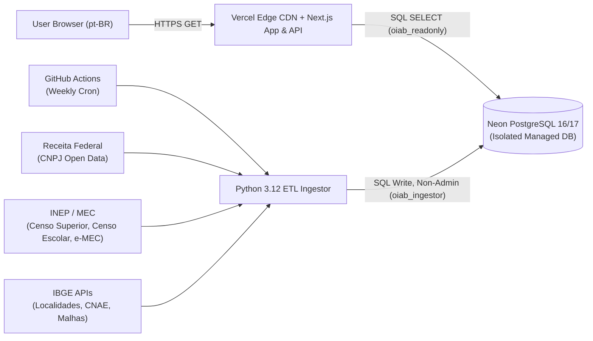

# OIAB — Technology Stack (`$0.00` Budget)

## Overview

This document defines the complete zero-cost (`N5.1`) technology stack selected to satisfy every functional (`F1.1`–`F5.1`) and non-functional (`N1.1`–`N5.1`) requirement in [REQUIREMENTS.md](./REQUIREMENTS.md).

- **Estimated Monthly Operating Cost**: **`$0.00 / month`** (100% open-source software + permanent free-tier cloud services, with no credit card expiration traps).
- **UI & Report Language**: Brazilian Portuguese (`pt-BR`) per `F5.1`.
- **Code, Comments, Logs & Engineering Docs**: English per [INSTRUCTIONS.md](./INSTRUCTIONS.md).

---

## High-Level Architecture

---

## Technology Stack by Layer

### 1. Frontend & Full-Stack Web Framework

| Tool | Role | Cost | Requirements | Justification |
| :--- | :--- | :--- | :--- | :--- |
| **Next.js (App Router) + React 19 + TypeScript** | Web UI + Read-only REST API Route Handlers (`/api/*`) | `$0` (MIT) | `F1.1`, `F1.2`, `F5.1`, `N1.1`, `N1.2`, `N4.1` | Single TypeScript codebase for frontend and backend APIs; eliminates separate backend hosting cold-starts (unlike Render's 15-min spin-down); supports built-in HTTP caching and strict type safety across API contracts. |
| **Tailwind CSS + shadcn/ui (Radix UI)** | Styling & accessible UI components | `$0` (MIT) | `F1.1`, `F2.5`–`F2.13`, `F5.1` | Fast, maintainable styling with accessible multi-select comboboxes, filter drawers, and responsive dashboards tailored cleanly in `pt-BR`. |
| **MapLibre GL JS (`maplibre-gl` + `react-map-gl`)** | Interactive vector map & choropleth drill-down | `$0` (BSD-3-Clause) | `F2.1`–`F2.4`, `N1.1` | Hardware-accelerated WebGL map engine requiring no paid Mapbox token; smoothly renders Brazil's 5 regions, 27 states, 5,570 municipalities, and clustered institution markers well under the 5 s transition limit. |
| **OpenFreeMap + IBGE TopoJSON (`topojson-client`)** | Basemap tiles & compressed official Brazilian boundaries | `$0` (Open / Public Domain) | `F2.1`, `N1.1`, `N1.4`, `N5.1` | OpenFreeMap provides unlimited free vector basemap tiles without API keys; converting IBGE meshes to TopoJSON reduces polygon payloads by ~75% for sub-second drill-down navigation and long-lived CDN caching. |
| **Recharts** | Interactive statistical charts | `$0` (MIT) | `F3.1`, `F5.1` | Composable React SVG charting library for filtered breakdowns (totals by type, regional/state rankings, CNAE segments, knowledge areas, and industry-to-academia ratios). |
| **jsPDF + `jspdf-autotable`** | Client-side PDF report generation | `$0` (MIT) | `F3.2`, `F3.3`, `F5.1`, `N5.1` | Generates structured, UTF-8 `pt-BR` PDF reports directly in the browser with OIAB and official data-source attribution, applied filters, and timestamps—incurring zero serverless compute cost and easy unit testing. |
| **TanStack Query (React Query)** | Client-side data fetching & caching | `$0` (MIT) | `N1.1`, `N1.2`, `N1.4` | Deduplicates requests and caches map levels and filter combinations in browser memory, preventing redundant network calls when navigating back and forth. |

### 2. Backend API, Security & Caching

| Tool | Role | Cost | Requirements | Justification |
| :--- | :--- | :--- | :--- | :--- |
| **Next.js Route Handlers (`GET`-only)** | Read-only backend API endpoints | `$0` (MIT) | `F1.2`, `F2.2`–`F2.13`, `F3.1`, `N3.1` | Public unauthenticated endpoints strictly expose `GET` operations; no write/mutation endpoints exist on the web server, drastically reducing attack surface. |
| **Zod** | Runtime input & query-parameter validation | `$0` (MIT) | `N3.1`, `N4.1` | Validates and sanitizes every filter parameter (UF codes, IBGE city IDs, CNAE codes, course/area IDs, name search length, pagination) before any database query executes. |
| **Drizzle ORM + `@neondatabase/serverless`** | Type-safe SQL query builder & serverless Postgres driver | `$0` (Apache-2.0) | `N1.2`, `N2.2`, `N3.1`, `N3.2` | Enforces 100% parameterized queries (prevents SQL injection), keeps serverless bundle size minimal, and connects cleanly over Neon's built-in PgBouncer connection pooler. |
| **Multi-Tier Caching Strategy** (TanStack Query + HTTP `Cache-Control` / Vercel Edge CDN + PostgreSQL Materialized Views) | Multi-layer response & aggregation caching | `$0` (Built-in) | `N1.1`, `N1.2`, `N1.3`, `N1.4` | Combines browser query cache, CDN edge caching (`s-maxage=3600, stale-while-revalidate=86400`), and pre-aggregated PostgreSQL summary views refreshed after weekly ingestion—delivering sub-second responses with zero extra paid cache services. |
| **Security Headers + CORS + Rate Limiting** (Next.js middleware / Vercel Firewall Free) | Endpoint hardening & abuse prevention | `$0` (Built-in) | `N3.1`, `N3.4`, `N3.5` | Enforces HTTPS/HSTS, CSP, `X-Content-Type-Options: nosniff`, `X-Frame-Options: DENY`, same-origin CORS, and per-IP rate limiting to mitigate scraping/DoS on public endpoints. |

### 3. Isolated Relational Database

| Tool | Role | Cost | Requirements | Justification |
| :--- | :--- | :--- | :--- | :--- |
| **Neon (PostgreSQL 16/17 — Free Tier)** | Isolated managed relational database | `$0 / month` (1 GB storage, 100 CU-hrs/mo, up to 2 CU autoscale, PgBouncer up to 10k pooled connections) | `N1.3`, `N2.1`, `N2.2`, `N3.2`, `N3.3`, `N5.1` | Fully isolated relational service that never expires (unlike Render's 30-day free Postgres) and never hard-pauses after 7 days (unlike Supabase Free). Supports native PostgreSQL `CREATE ROLE` least-privilege separation (`oiab_readonly` for the backend; non-admin `oiab_ingestor` for weekly writes), `pg_trgm` + `unaccent` indexes for fast Portuguese name search (`F2.12`), and easily fits the ~100k–150k CNAE Section C manufacturing records + ~25k educational institutions (~120–200 MB total with indexes). |
| **Docker Compose (`postgres:16-alpine`)** | Local development & integration-test database | `$0` (Open Source) | `N2.1`, `N2.2`, `N4.2` | Replicates the exact Neon schema, extensions (`pg_trgm`, `unaccent`), and least-privilege roles (`oiab_readonly`, `oiab_ingestor`) locally and in CI. |

### 4. Automated Weekly Data Ingestor

| Tool | Role | Cost | Requirements | Justification |
| :--- | :--- | :--- | :--- | :--- |
| **Python 3.12+ (`httpx`, `polars` / stdlib `zipfile` & `csv`, `psycopg[binary]`)** | Streaming ETL data ingestion pipeline | `$0` (PSF / MIT / LGPL) | `F4.1`–`F4.4`, `N3.3` | Streams multi-GB Receita Federal ZIP archives one file at a time with minimal RAM/disk footprint; filters strictly to active non-MEI, non-micro-enterprise CNAE Section C companies (`F4.4`), normalizes education datasets, and performs atomic staging-table swaps via PostgreSQL `COPY` using `oiab_ingestor`. |
| **GitHub Actions (Scheduled Cron Workflow)** | Weekly ingestion scheduler & CI/CD runner | `$0 / month` (Unlimited minutes on public repos; 2,000 min/mo on private repos) | `F4.1`, `F4.2`, `F4.3`, `N3.3`, `N3.5`, `N4.1`, `N4.2`, `N5.1` | Runs weekly (`cron`) to check source `ETag`/`Last-Modified`/release metadata against the `ingestion_runs` table—skipping writes and preserving existing data if unchanged or unreachable (`F4.3`). Keeps write credentials isolated in GitHub Secrets, completely separated from the web server (`N3.3`, `N3.5`). |

### 5. Hosting, Testing & Code Quality

| Tool | Role | Cost | Requirements | Justification |
| :--- | :--- | :--- | :--- | :--- |
| **Vercel (Hobby Free Tier)** | Web application & API hosting + global CDN | `$0 / month` (100 GB bandwidth/mo, automatic HTTPS, Git previews) | `F1.1`, `F1.2`, `N1.1`–`N1.4`, `N3.1`, `N3.4`, `N5.1` | Sub-second serverless execution (meets `N1.1` ≤ 5 s and `N1.2` ≤ 10 s), effortless handling of ≥ 10 simultaneous users (`N1.3`), encrypted environment variable management (`N3.4`), and zero-config HTTPS. *(Note: Hobby tier is for non-commercial/open projects; app remains standard Node.js/Next.js for portability.)* |
| **GitHub** | Source control, issue tracking & secret store | `$0 / month` | `N3.5`, `N4.1`, `N4.2`, `N5.1` | Free repository hosting, branch protection, GitHub Actions CI/CD, and encrypted Actions Secrets for the ingestor. |
| **Vitest + React Testing Library** | TypeScript/React unit & API integration tests | `$0` (MIT) | `N4.1`, `N4.2` | Fast unit testing for every functional requirement (`F1`–`F5`), filter query builders, statistics calculations, PDF metadata, and API handlers. |
| **pytest** | Python ingestor unit & integration tests | `$0` (MIT) | `N4.1`, `N4.2`, `F4.1`–`F4.4` | Validates CNAE Section C / active / non-MEI / non-micro-enterprise filtering rules, idempotent no-op checks, and staging-to-production DB swaps. |
| **Playwright** | End-to-end browser integration tests | `$0` (Apache-2.0) | `N4.2`, `F1.1`–`F3.3`, `F5.1` | Verifies real browser flows: unauthenticated access, map drill-downs, combined filters, Portuguese UI, statistics updates, and PDF export. |
| **ESLint + Prettier + Ruff + Gitleaks** | Linting, formatting & hardcoded-secret scanning | `$0` (MIT) | `N3.5`, `N4.1` | Enforces code quality in TypeScript and Python and automatically blocks commits containing hardcoded credentials (`N3.5`). |

---

## Official, Free Brazilian Data Sources (`F4.1`, `F3.3`)

| Domain | Official Source | Cost | Typical Release Cadence | Usage in OIAB |
| :--- | :--- | :--- | :--- | :--- |
| **Manufacturing Companies** | **Receita Federal do Brasil (RFB)** — *Dados Abertos CNPJ* (`arquivos.receitafederal.gov.br` / `dados.gov.br`) | `$0` | Monthly | Active (`situacao_cadastral = 02`), non-MEI (`opcao_mei != S`), non-micro-enterprise (`porte` excluding ME) establishments in **CNAE Section C** (`10`–`33`), mapping Division → `segment` (`F2.10`) and Class/Subclass → `product type` (`F2.11`). |
| **Universities & Higher Education Courses** | **INEP / MEC** — *Censo da Educação Superior* & *Cadastro e-MEC* (`gov.br/inep`, `dadosabertos.mec.gov.br`) | `$0` | Annual / Periodic | Higher education institutions (IES), campuses/municipalities, CINE Brasil knowledge areas (`F2.9`), and courses (`F2.8`). |
| **Technical Schools & Courses** | **INEP / MEC** — *Censo Escolar (Educação Profissional)* & *SISTEC / CNCT* (`gov.br/inep`, `dadosabertos.mec.gov.br`) | `$0` | Annual / Periodic | Technical schools (*Escolas Técnicas / Institutos Federais / Sistema S*), municipalities, technological axes / knowledge areas (`F2.9`), and technical courses (`F2.8`). |
| **Geography, Localities & CNAE Taxonomy** | **IBGE** — *API de Localidades*, *API de CNAE*, *API de Malhas Geográficas* (`servicodados.ibge.gov.br`) | `$0` | Stable / Periodic | Authoritative Region → State (UF) → Municipality (7-digit IBGE code) hierarchy, CNAE Section C labels, and GeoJSON/TopoJSON map boundaries (`F2.1`). |

---

## Requirement Traceability Matrix

| Requirement | Satisfied By |
| :--- | :--- |
| `F1.1`, `F1.2` | Next.js web app deployed on Vercel (public HTTPS, no login wall) |
| `F2.1` | MapLibre GL JS + OpenFreeMap + IBGE TopoJSON meshes (country → region → state → city) |
| `F2.2`–`F2.7` | Neon PostgreSQL relational geo hierarchy (`regions` → `states` → `cities`) + Next.js `GET` API + MapLibre panels |
| `F2.8`, `F2.9` | Normalized `knowledge_areas` and `courses` tables (INEP/e-MEC/SISTEC) + filter UI |
| `F2.10`, `F2.11` | Normalized `cnae_divisions` (segment) and `cnae_classes` (product type) tables (IBGE/RFB) + filter UI |
| `F2.12` | PostgreSQL `pg_trgm` + `unaccent` indexed text search across companies and educational institutions |
| `F2.13` | Unified multi-entity filter API & UI supporting simultaneous company + education filters |
| `F3.1` | PostgreSQL filtered aggregations + materialized views + Recharts dashboard components |
| `F3.2`, `F3.3` | Browser-side PDF export via `jsPDF` + `jspdf-autotable` embedding OIAB attribution, RFB/INEP/IBGE citations, active filters, and data timestamp |
| `F4.1`–`F4.4` | GitHub Actions weekly cron + Python 3.12 streaming ETL with metadata-based idempotency (`ingestion_runs`) and strict CNAE Section C / active / non-MEI / non-ME filters |
| `F5.1` | Dedicated `pt-BR` UI copy, `Intl.NumberFormat('pt-BR')` / `DD/MM/AAAA` formatting, and `pt-BR` PDF templates |
| `N1.1`, `N1.2` | TopoJSON boundary compression, indexed Postgres queries + materialized views, Vercel Edge CDN, sub-second serverless execution |
| `N1.3` | Vercel serverless concurrency + Neon PgBouncer pooling (up to 10,000 pooled connections) + CDN edge caching |
| `N1.4` | 3-tier cache: TanStack Query (browser) + Vercel Edge `Cache-Control` (CDN) + PostgreSQL materialized views (DB) |
| `N2.1`, `N2.2` | Isolated Neon PostgreSQL managed service with normalized 3NF relational schema + foreign keys |
| `N3.1` | HTTPS/HSTS, `GET`-only public routes, Zod validation, Drizzle parameterized SQL, CORS restrictions, security headers, rate limiting |
| `N3.2`, `N3.3` | Dedicated PostgreSQL roles: `oiab_readonly` (`SELECT` only for Next.js backend) and `oiab_ingestor` (DML write only, no `SUPERUSER`/`CREATEROLE`/`CREATEDB`/DDL admin privileges) |
| `N3.4`, `N3.5` | Vercel Environment Variables + GitHub Actions Secrets + `.gitignore` + Gitleaks CI scanning |
| `N4.1`, `N4.2` | Vitest + React Testing Library + pytest (unit tests per requirement) + Playwright & Docker Postgres (integration tests) |
| `N5.1` | All tools are open-source (`$0`) and all cloud services operate strictly within permanent free tiers (`$0 / month`) |

---

## Free-Tier Guardrails

To keep the platform permanently within `$0.00 / month`:

1. **Neon Storage (`1 GB` cap)**: CNAE Section C active companies (excluding MEIs & micro-enterprises) + INEP universities/technical schools + IBGE lookup tables are projected at **~120–200 MB** including indexes (< 25% of the 1 GB free quota).
2. **Neon Compute (`100 CU-hours/month`)**: Aggressive Vercel Edge CDN caching (`s-maxage=3600`) and TanStack Query caching minimize redundant database hits so Neon scales to zero between traffic bursts.
3. **GitHub Actions Disk (`~14 GB` free)**: The Python ingestor downloads, streams, filters, and deletes Receita Federal CNPJ ZIP files **one archive at a time** so peak disk usage stays under ~2 GB.
4. **Zero-Cost PDF Generation**: PDF reports are rendered entirely client-side (`jsPDF`), avoiding serverless memory/timeout limits and extra backend infrastructure.
